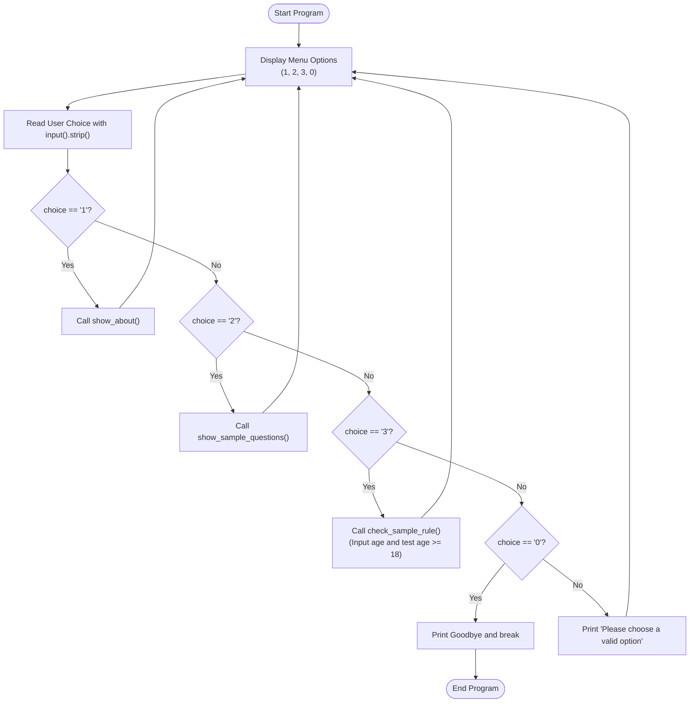

# Day 1 Complete Beginner's Guide: Python Basics & UdyamSathi CLI Architecture

Welcome to the comprehensive Day 1 guide for **UdyamSathi (उद्यमसाथी)**. This document breaks down every single line of code, programming concept, and terminal command used in `day01_intro.py` and `day01_menu.py`. It is written to be accessible to beginner classmates while adhering to clean Python engineering standards.

---

## Table of Contents
1. [Core Python Concepts Introduced](#1-core-python-concepts-introduced)
2. [Deep Dive: day01_intro.py (Line-by-Line Breakdown)](#2-deep-dive-day01_intropy-line-by-line-breakdown)
3. [Deep Dive: day01_menu.py (Line-by-Line Breakdown)](#3-deep-dive-day01_menupy-line-by-line-breakdown)
4. [Control Flow: Understanding While Loops & Conditionals](#4-control-flow-understanding-while-loops--conditionals)
5. [Git & Version Control Workflow](#5-git--version-control-workflow)
6. [Best Practices for Classmates](#6-best-practices-for-classmates)

---

## 1. Core Python Concepts Introduced

Before examining the code, let us understand the fundamental programming building blocks used on Day 1:

| Term | What It Means | Why We Use It in UdyamSathi |
|---|---|---|
| **Variable** | A named storage container in computer memory holding data. | Stores user inputs like `name`, `age`, and `choice`. |
| **String (`str`)** | A sequence of characters enclosed in single or double quotes. | Represents scheme descriptions, applicant names, and text prompts. |
| **Integer (`int`)** | A whole number without a decimal point. | Represents numerical values like applicant age (`age = 28`). |
| **Type Casting** | Converting data from one type to another (e.g. `int("25")` $\to 25$). | Converts raw keyboard input strings into calculable numbers. |
| **F-String** | Formatted string literals prefixed with `f"..."` allowing expressions inside `{}`. | Dynamically injects user names and questions into output messages. |
| **Function (`def`)** | A reusable block of code that performs a specific action. | Modularizes actions (`show_about()`, `check_sample_rule()`). |
| **While Loop** | A control loop that continues running as long as a condition is `True`. | Keeps the interactive menu active until the user presses `0` to exit. |
| **Conditional Branching** | Using `if`, `elif`, and `else` to make decisions based on boolean logic. | Routes menu choices and evaluates whether age $\ge 18$. |

---

## 2. Deep Dive: day01_intro.py (Line-by-Line Breakdown)

Here is the complete source of `day01_intro.py`:

```python
# Line 1: Comment explaining script purpose
# Basic introduction to udyamSathi and its features.

# Lines 3-5: Visual CLI Header
print("============================================")
print("welcome to UDYAMSATHI - Your personal guide to PMEGP and CMEGP schemes")
print("============================================")
print()

# Lines 8-9: Product Problem & User Value Proposition
print("\nUdyamsathi helps small business starters understand PMEGP and CMEGP schemes in Maharashtra")
print("\nIt provides information on eligibility, subsidy amounts, and required documents for these schemes.")
print()

# Lines 12-13: Interactive User Input
name = input("What is your name sir? ")
que = input("Would you like to know about PMEGP or CMEGP schemes? ")

# Lines 15-17: Personalized Response using F-strings
print()
print(f"Hello {name} We are glad to have you! ")
print(f"You have asked : {que} \nWe can surely assist you regarding this ")
```

### Line-by-Line Technical Explanation:
* **Line 1 (`# ...`)**: Comments start with a hash symbol `#`. The Python interpreter ignores comments completely; they exist solely for developers to read.
* **Lines 3–5 (`print(...)`)**: The `print()` built-in function sends text to the standard output (your console terminal). The equal signs create visual dividers.
* **Line 6 (`print()`)**: Calling `print()` without arguments outputs a blank newline, creating clean visual spacing.
* **Lines 8–9 (`\n...`)**: `\n` is an **escape character** representing a newline break. It forces the text following it onto a fresh line.
* **Line 12 (`name = input(...)`)**: 
  - `input()` pauses program execution and waits for the user to type text on their keyboard and press Enter.
  - The string inside quotes is the **prompt** shown to the user.
  - The typed value is returned as a `str` and assigned to the variable `name`.
* **Line 16 (`f"Hello {name}..."`)**:
  - The `f` prefix indicates an **f-string** (formatted string literal).
  - Python replaces `{name}` with the actual value stored in the `name` variable at runtime. This is much cleaner and faster than old string concatenation (`"Hello " + name`).

---

## 3. Deep Dive: day01_menu.py (Line-by-Line Breakdown)

Here is the structure of `day01_menu.py`:

```python
# A simple menu for exploring UdyamSathi.

def show_about():
    print("\nUdyamSathi helps small-business starters understand PMEGP and CMEGP.")


def show_sample_questions():
    print("\nSample questions:")
    print("- Am I eligible for PMEGP?")
    print("- How much subsidy could I receive?")
    print("- What documents are needed for CMEGP?")
    print()
    print("These are just the sample questions. For more features, stay TUNED !!!")


def check_sample_rule():
    age = int(input("\nPlease Enter your age: "))
    if age >= 18:
        print("Based on age alone, you meet this sample minimum-age check.")
    else:
        print("Based on age alone, you do not meet this sample minimum-age check.")
    print()
    print("This is only a demonstration rule, not a final government eligibility decision. for more features stay TUNED !!!")


while True:
    print("\n=== UdyamSathi Menu ===")
    print("1. About UdyamSathi")
    print("2. Sample questions")
    print("3. Sample eligibility rule check")
    print("0. Exit")

    choice = input("Choose an option: ").strip()

    if choice == "1":
        show_about()
    elif choice == "2":
        show_sample_questions()
    elif choice == "3":
        check_sample_rule()
    elif choice == "0":
        print("Goodbye! Have a NICE DAY")
        break
    else:
        print("Please choose a valid option.")
```

### Detailed Breakdown of Key Functions:

#### 1. Function Definition (`def show_about():`)
- In Python, functions are defined using the `def` keyword followed by the function name, parentheses `()`, and a colon `:`.
- The indented lines below the definition form the **function body**. Python uses 4 spaces for indentation rather than curly braces `{}` used in C++ or Java.

#### 2. Input Type Casting (`age = int(input(...))`)
- `input()` **always** returns text as a string (`"25"`), even if the user types numbers.
- If you compare a string with a number like `"25" >= 18`, Python raises a `TypeError: '>=' not supported between instances of 'str' and 'int'`.
- Wrapping `input()` in `int(...)` converts the string `"25"` into the integer `25`, enabling arithmetic comparisons.

#### 3. Stripping Whitespace (`choice.strip()`)
- The `.strip()` method removes any accidental leading or trailing spaces entered by the user (e.g. typing `" 1 "` becomes `"1"`). This prevents silent input matching failures.

---

## 4. Control Flow: Understanding While Loops & Conditionals



### The Power of `while True:` and `break`
- `while True:` creates an **infinite loop** that runs forever unless explicitly halted.
- When the user selects `0`, Python enters the `elif choice == "0":` branch where the `break` statement resides.
- The `break` statement immediately breaks out of the enclosing loop, gracefully terminating the console application.

---

## 5. Git & Version Control Workflow

On Day 1, version control is essential to capture your first baseline commit:

```powershell
# Initialize git repository
git init

# Check status of tracked and untracked files
git status

# Stage files for commit
git add README.md day01_intro.py day01_menu.py

# Record commit with descriptive message
git commit -m "Day 1 - Initialize UdyamSathi repository with intro and interactive CLI menu"

# Link local repository to GitHub remote
git remote add origin https://github.com/sameeeerjadhav/cream-AI.git

# Push changes to default master branch
git push -u origin master
```

---

## 6. Best Practices for Classmates
1. **Never hardcode paths**: Always use relative paths or `pathlib.Path` so your scripts run seamlessly on Windows, Linux, and macOS.
2. **Handle bad inputs defensively**: Wrap numeric inputs in `try / except ValueError:` blocks to prevent crashing if a user types words instead of numbers.
3. **Keep functions focused**: Each function should perform exactly one task (Single Responsibility Principle).
4. **Use f-strings for readability**: Replace string concatenation (`"Age: " + str(age)`) with `f"Age: {age}"`.
